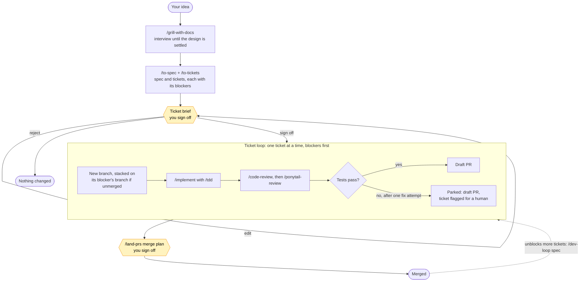

# heroloop

[](https://github.com/musickevan1/heroloop/actions/workflows/check.yml)

A plain, tool-agnostic dev workflow for AI coding agents: take an idea from a design interview to merged pull requests, with you signing off at the two moments that matter.

- **Works in any agent tool.** Every piece is a Markdown `SKILL.md` in the open [Agent Skills](https://agentskills.io) format: GitHub Copilot (VS Code), Cursor, Codex and Claude Code all read it.
- **Transparent.** No plugin, server, or background automation. Each step is written out in a file you can read in a minute.
- **You stay in control.** The agent plans and builds; nothing is merged, force-pushed or closed until you sign off.
- **Minimal code by default.** [Ponytail](https://github.com/DietrichGebert/ponytail) pushes every change toward the simplest thing that works.

It bundles Matt Pocock's [AI Hero skills](https://github.com/mattpocock/skills) for planning, building and review, Ponytail for simplicity, and two skills of its own, `dev-loop` and `land-prs`, that tie them into a loop. It is an independent bundle, not affiliated with or endorsed by either project ([credits](#credits)).

## Quick start

**Let your agent do it.** Paste this into agent chat (Copilot agent mode, Cursor, Codex or Claude Code):

```text
Set up heroloop on this machine by following https://raw.githubusercontent.com/musickevan1/heroloop/main/SETUP.md
```

It checks prerequisites, clones the repo, installs the skills and the always-on guidance for your tool, and asks before installing anything or touching files it didn't create. The steps are in [SETUP.md](SETUP.md).

**Or by hand.** Needs `git` and the [GitHub CLI](https://cli.github.com) (run `gh auth login` once).

**Windows** (PowerShell):

```powershell
git clone https://github.com/musickevan1/heroloop $HOME\heroloop
& $HOME\heroloop\install.ps1
```

**macOS / Linux / WSL**:

```sh
git clone https://github.com/musickevan1/heroloop ~/heroloop
~/heroloop/install.sh
```

Then paste [AGENTS.global.md](AGENTS.global.md) into your tool's personal instructions ([where](#setup-per-tool)), open a repo, and in agent chat:

```text
/setup-matt-pocock-skills                       once per repo: where tickets live
/dev-loop add CSV export to the reports page    plan, sign off, build as PRs
/land-prs                                       merge them in order
```

## How it works



1. **Plan.** `/dev-loop <idea>` grills you about the idea (`/grill-with-docs`, which also records decisions and terms as docs), then writes a spec and splits it into tickets: thin vertical slices, each naming the tickets that block it.
2. **Ticket brief.** The agent shows one table: each ticket, what blocks it, which branch it will build on, and the test command that proves it works. You sign off, ask for edits, or reject.
3. **Build.** For each ticket, in dependency order: a branch `ticket/<n>-<slug>`, a test-first implementation, a code review and a simplicity review, the test command, then a draft PR. A ticket whose blocker is still unmerged builds on the blocker's branch, so PRs form a **stack**. A ticket that stays red after one fix attempt is **parked**: its work goes up as a draft PR, flagged for you.
4. **Land.** `/land-prs` shows a merge plan per repo (stacks bottom-up, then oldest first), plus what is blocked and why. On your sign-off it merges in order, stopping at the first red check, conflict or refused merge.
5. **Repeat.** Merges unblock tickets that were waiting; `/dev-loop <spec>` picks up where the last pass stopped, since tickets with PRs count as done.

Terms are defined in [skills/dev-loop/GLOSSARY.md](skills/dev-loop/GLOSSARY.md); the full steps are in [dev-loop](skills/dev-loop/SKILL.md) and [land-prs](skills/land-prs/SKILL.md).

### What each sign-off allows

| Checkpoint | The agent may | The agent never |
|---|---|---|
| Before any sign-off | read code, the tracker and GitHub; write the spec and tickets you asked for | create branches, push, or open PRs |
| Ticket brief | create the listed branches, commit, push them, open draft PRs, flag parked tickets | merge, force-push, or touch other branches |
| Merge plan | mark PRs ready, merge the listed PRs in order, close PRs you agreed to close | bypass branch protection or required reviews; force-push without asking that time |

## Skills

**The loop** (this repo):

| Skill | What it does |
|---|---|
| `dev-loop` | Idea or spec → ticket brief → sign-off → one draft PR per ticket |
| `land-prs` | Your open PRs → merge plan per repo → sign-off → merged in order |

**Plan** (AI Hero):

| Skill | What it does |
|---|---|
| `grill-with-docs` | Relentless interview on a plan, recording ADRs and glossary terms as it goes |
| `grill-me`, `grilling` | The same interview, without the docs |
| `to-spec` | Turn the conversation into a spec on your tracker |
| `to-tickets` | Split a spec into tracer-bullet tickets with blocking edges |
| `research` | Investigate a question against primary sources, saved as Markdown |
| `prototype` | Throwaway prototype to answer a design question |
| `wayfinder` | Plan work too big for one session as a map of decision tickets |
| `to-questionnaire` | Turn an open decision into questions for someone else |

**Build and review** (AI Hero):

| Skill | What it does |
|---|---|
| `implement`, `implement-spec` | Build a ticket or a whole spec |
| `tdd` | Red-green-refactor, test-first |
| `diagnosing-bugs` | Diagnosis loop for hard bugs and performance regressions |
| `code-review` | Review a diff against the repo's standards and the originating spec |
| `pr` | Write a PR body |
| `codebase-design`, `improve-codebase-architecture` | Deep-module design vocabulary; find and fix shallow modules |
| `domain-modeling` | Maintain the glossary and ADRs |

**Simplicity** (Ponytail):

| Skill | What it does |
|---|---|
| `ponytail` | Always-on minimal-solution mode (levels `lite`, `full`, `ultra`) |
| `ponytail-review` | Review a diff only for over-engineering: what to delete |
| `ponytail-audit` | The same, across a whole repo |
| `ponytail-debt` | Collect deliberate shortcuts marked `ponytail:` into a ledger |
| `ponytail-help`, `ponytail-gain` | Quick reference; measured impact |

**Session and repo** (AI Hero):

| Skill | What it does |
|---|---|
| `ask-matt` | Not sure which skill fits? Ask this one |
| `setup-matt-pocock-skills` | Once per repo: tracker (GitHub, GitLab, local Markdown, Jira…), labels, docs layout |
| `handoff` | Compact a long session into a doc a fresh one can pick up |
| `retro` | Retrospective on a session |
| `triage` | Move incoming issues and external PRs to agent-ready briefs |
| `teach`, `wait-what`, `wizard`, `writing-for-agents` | Learn a concept; re-explain the last message; generate a setup wizard; write skills and AGENTS.md |

## Setup per tool

The install scripts link every skill into `~/.agents/skills`. Skills load on demand, but the Ponytail default and the flow overview belong in every chat, so paste [AGENTS.global.md](AGENTS.global.md) once into your tool's personal instructions.

| Tool | Reads skills from | Paste AGENTS.global.md into |
|---|---|---|
| GitHub Copilot (VS Code) | `~/.agents/skills` ✓ | Command Palette → *Chat: New Instructions File* → *User*, below front matter `applyTo: "**"` |
| Cursor | `~/.agents/skills` ✓ | Settings → Rules → *User Rules* |
| Codex | `~/.agents/skills` ✓ | `~/.codex/AGENTS.md` |
| Claude Code | `~/.claude/skills`: run `install.ps1 ~\.claude\skills` or `install.sh ~/.claude/skills` | `~/.claude/CLAUDE.md` |

Type `/` in agent chat to see the skills. Only add `~/.claude/skills` if you use Claude Code: Copilot and Cursor read that folder too and would show each skill twice.

**Share with a team** by copying the skills into a repo instead: `install.ps1 -Copy .github\skills` or `install.sh --copy .github/skills`.

### Already have AI Hero or Ponytail?

heroloop never overwrites a skill it didn't install, so nothing breaks, but you can end up with two copies:

| You already have | What happens | To use heroloop's copy |
|---|---|---|
| The skills in `~/.agents/skills` | The installer skips those names (`skip ...`); `dev-loop` uses your copies | Delete those folders, re-run the installer |
| The skills in another folder your tool reads (`~/.claude/skills`, `~/.copilot/skills`, `~/.cursor/skills`) | Both copies load; the tool lists each skill twice | Delete the other copies |
| The Claude Code plugins | Claude Code shows both `/ponytail` and `/ponytail:ponytail` | `claude plugin uninstall <plugin>` |

[SETUP.md](SETUP.md) checks for all three and asks which copy you want to keep.

## Updating

```sh
git -C ~/heroloop pull
```

Installs are links into this repo, so a pull is the whole update. Re-run the install script only when skills were added or removed (it also cleans up links to deleted ones), or if you installed with `-Copy` / `--copy`.

## Uninstall

1. Remove the skills. This deletes only what heroloop installed; links are removed without touching what they point to, and skills you installed yourself stay.
   - Windows: `& $HOME\heroloop\install.ps1 -Uninstall` (add any other folders you installed into, e.g. `$HOME\.claude\skills`)
   - macOS / Linux: `~/heroloop/install.sh --uninstall` (same: add other folders)
2. Remove the always-on guidance: the `heroloop:start` … `heroloop:end` block in `~/.codex/AGENTS.md` or `~/.claude/CLAUDE.md`, the `heroloop.instructions.md` file in VS Code (*Chat: Open Customizations*), or the text you pasted into Cursor's *User Rules*.
3. Delete the clone: `~/heroloop`.

## Repo layout

```text
skills/            this repo's own skills: dev-loop (with its glossary), land-prs
vendor/            upstream skills, copied unchanged (see vendor/README.md)
AGENTS.global.md   always-on guidance for your tool's personal instructions
SETUP.md           step-by-step install for an agent to follow
install.ps1        install on Windows (directory junctions, no admin needed)
install.sh         install on macOS / Linux / WSL (symlinks)
sync.sh            maintainers: refresh vendor/ from upstream
UPSTREAM.lock      the upstream commits vendor/ was copied from
.github/workflows/ CI: installs on Windows, macOS and Linux, and checks the skills
```

Maintainers refresh upstream with `./sync.sh` (Git Bash works on Windows), review `git diff`, and open a PR: CI runs both installers on Windows (PowerShell 7 and 5.1), macOS and Linux, and checks that every skill's `name` matches its folder and every `/skill` reference is a skill this repo ships.

## Troubleshooting

- **Skills don't show up after typing `/`.** Restart the editor, then check the folder: `ls ~/.agents/skills` (PowerShell: `dir $HOME\.agents\skills`) should list `dev-loop`, `land-prs` and the rest.
- **"running scripts is disabled on this system".** Run `powershell -ExecutionPolicy Bypass -File $HOME\heroloop\install.ps1`.
- **The install script says `skip ...`.** A skill of that name already exists and was not installed by heroloop; it is left alone. Remove it to let heroloop manage that name.
- **`/code-review` behaves differently in Claude Code.** Claude Code's built-in `/code-review` takes precedence over the AI Hero skill there; other tools use the AI Hero one.
- **Long sessions.** Each ticket is sized for one fresh context. If your tool supports subagents, `dev-loop` hands each ticket to one; otherwise run `/handoff` between tickets and continue with `/dev-loop <spec>` in a new chat.
- **Cloud agents.** PRs opened by cloud agents (such as Copilot's coding agent) can be landed with `/land-prs` like any other.

## Credits

Most of the skills here are not mine. They are copied unchanged from:

- **AI Hero** by Matt Pocock: [mattpocock/skills](https://github.com/mattpocock/skills), MIT ([license](LICENSES/mattpocock-skills.LICENSE)). The planning, building, review and session skills.
- **Ponytail** by DietrichGebert: [DietrichGebert/ponytail](https://github.com/DietrichGebert/ponytail), MIT ([license](LICENSES/ponytail.LICENSE)). The `ponytail*` skills.

The exact upstream commits are in [UPSTREAM.lock](UPSTREAM.lock). The skill format is the open [Agent Skills](https://agentskills.io) standard. This repo's own files (`skills/`, scripts, docs) are MIT, see [LICENSE](LICENSE).

heroloop is an independent project. It is not affiliated with, endorsed by, or supported by Matt Pocock, AI Hero, or the Ponytail project; report problems with heroloop here, not upstream.
